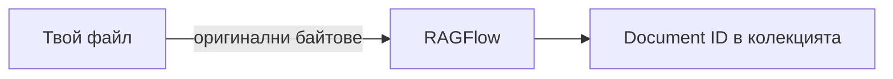
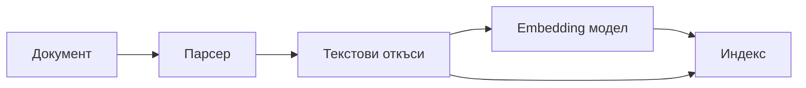
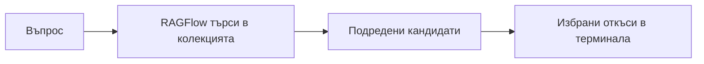
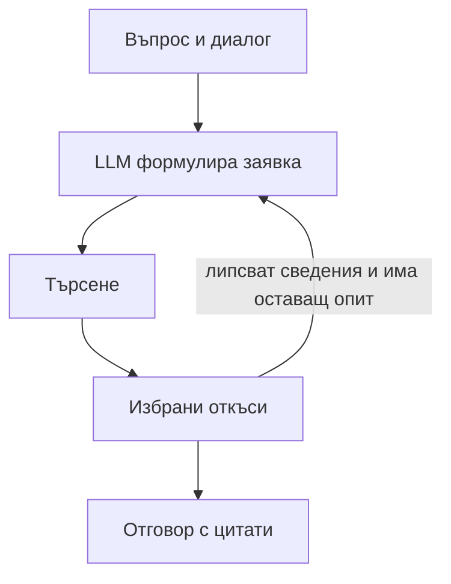

# rag-demo-system

Терминален урок по retrieval-augmented generation (RAG). Качваш свой документ, следиш как се индексира, задаваш въпрос и виждаш точните откъси, от които езиковият модел съставя отговора. Можеш да изпълниш всеки етап в отделен терминал.

## Първо пускане

Трябват Python 3.10+, работещ RAGFlow с API ключ за твоя акаунт и регистриран embedding модел. За чат ти трябва и LLM сървър с OpenAI-съвместими `/v1/models` и `/v1/chat/completions`. Клиентът е проверен с Go API на [RAGFlow v1.0.0](https://github.com/infiniflow/ragflow/tree/db1cd5929a7885a3074547791f5ecc4d2f891739). За собствен backend виж [инструкциите на RAGFlow](https://github.com/infiniflow/ragflow/tree/db1cd5929a7885a3074547791f5ecc4d2f891739/docker).

```sh
git clone https://github.com/damyan-deshev/rag-demo-system.git
cd rag-demo-system
export RAGFLOW_API_KEY='YOUR_RAGFLOW_API_KEY'
./demo
```

При първо пускане wizard-ът пита за адреса на RAGFlow (до корена на API сървъра) и показва embedding моделите, регистрирани в акаунта. След това пита за адреса на LLM (включително `/v1`) и показва наличните модели. Ако LLM сървърът изисква ключ, задай и `LLM_API_KEY`. Можеш да въведеш ID ръчно, да пропуснеш настройката с `n` или `./demo --skip-wizard` и да се върнеш с `w`. Адресите и имената се запазват локално. Ключовете идват от средата.

За предварително настроена среда:

```sh
export RAGFLOW_URL=http://localhost:9380
export EMBEDDING_MODEL='MODEL@INSTANCE@PROVIDER'
export LLM_URL=http://localhost:1234/v1
export LLM_MODEL='YOUR_SERVED_MODEL_ID'
./demo --skip-wizard
```

Embedding моделът превръща текст в списък от числа. RAGFlow използва избрания модел при създаване на колекцията, за да сравнява въпросите и пасажите в едно векторно пространство. За сравнение с друг encoder създай втора колекция и качи същия документ. LLM можеш да смениш от главното меню с `w` и веднага да зададеш същия въпрос върху същите откъси.

## Урок в четири терминала

В главното меню избери `n`, дай име на колекцията и копирай показания Collection ID. Във всеки терминал отвори директорията на проекта, осигури същите променливи за достъп и задай `export DS='YOUR_COLLECTION_ID'`.

### 1. Качване на оригинала

Първо изпращаме байтовете на файла, за да получим постоянен Document ID. За пълен пример от менюто избери `i` и навигирай по папките или въведи път. Менюто продължава направо към индексиране. За да покажеш качването отделно, изпълни:

```sh
./demo --skip-wizard --dataset "$DS" upload examples/station.txt
```



### 2. Индексиране

Копирай Document ID от предишната стъпка. Парсерът извлича текста, разделя го на откъси и embedding моделът изчислява вектор за всеки. Elasticsearch в референтния стек пази търсимите откъси и векторите им. Терминалът показва състоянието на задачата, процента, броя откъси и съобщенията на backend-а. При създаване на колекция можеш да зададеш целевия размер с `./demo --chunk-tokens 256`.

```sh
./demo --skip-wizard --dataset "$DS" index 'YOUR_DOCUMENT_ID'
```



Можеш да избереш файл с произволно име и разширение. Поддръжката на съдържанието зависи от парсера на RAGFlow. При EPUB с неподдържана от XML четеца кодировка на OPF каталога интерактивният ingest показва грешката и предлага повторен опит с отделно копие. В него само каталогът се прекодира в UTF-8.

### 3. Търсене без LLM

Въпросът минава през retrieval API на RAGFlow. Виждаш колко кандидати са се върнали и текста и идентификаторите на избраните откъси. Опитай с различен брой откъси и сравни каква информация би стигнала до модела.

```sh
./demo --skip-wizard --dataset "$DS" --context-chunks 2 search 'When did Aurora open?'
```



### 4. Разговор с книгата или документа

В чата LLM преобразува въпроса в заявка за търсене. С `--max-passes 3` оценява дали откъсите отговарят на целия въпрос и може да предложи нова заявка. Терминалът показва опитите и решението. Моделът получава избраните пасажи и връща отговор с препратки като `[S1]`. По подразбиране има едно търсене.

```sh
./demo --skip-wizard --dataset "$DS" --max-passes 3 --context-chunks 4 chat
```



## Запазване и изтриване

Изходът от терминала запазва колекцията, документите и индекса в RAGFlow. При собствено разгръщане запази дисковите томове на backend-а. За да продължиш утре, избери `o` в главното меню. В чат използвай `/sources` за последните източници. Празен ред приключва разговора и предлага да запазиш въпросите, заявките, откъсите и отговорите локално.

| Какво искаш да изтриеш | Път в менюто на отворена колекция |
|---|---|
| Един откъс | `d` → документ → `v` → откъс → `DELETE` |
| Документ и неговите откъси | `d` → документ → `d` → `DELETE` |
| Запазен разговор и копираните в него откъси | `t` → разговор → `DELETE` |
| Цяла колекция и локалните ѝ разговори | `x` → `DELETE` |

Оригиналният файл остава на твоя диск. Запазеният разговор е отделно локално копие. Ако премахваш и цитиран текст от него, изтрий съответния разговор през `t`. Настройките са в `$XDG_CONFIG_HOME/rag-demo-system` (по подразбиране `~/.config`), разговорите в `$XDG_DATA_HOME/rag-demo-system` (по подразбиране `~/.local/share`).

## Grafana

По желание можеш да покажеш на проектор достъпността на двата сървъра. В `monitoring/prometheus.yml` задай адресите на RAGFlow и LLM, видими от контейнера за проверки. При настройките по подразбиране той се свързва към портове 9380 и 1234 на Docker хоста.

```sh
docker compose -f monitoring/compose.yaml up -d
```

Отвори [локалната Grafana](http://localhost:3300), влез с началния Grafana акаунт (`admin` / `admin` при празен том) и отвори **RAG demo endpoints**. Графиките показват дали TCP връзката успява и колко време трае проверката. Процентът на индексиране, диагностиката на парсера и заявките на модела се виждат в съответния терминал.
